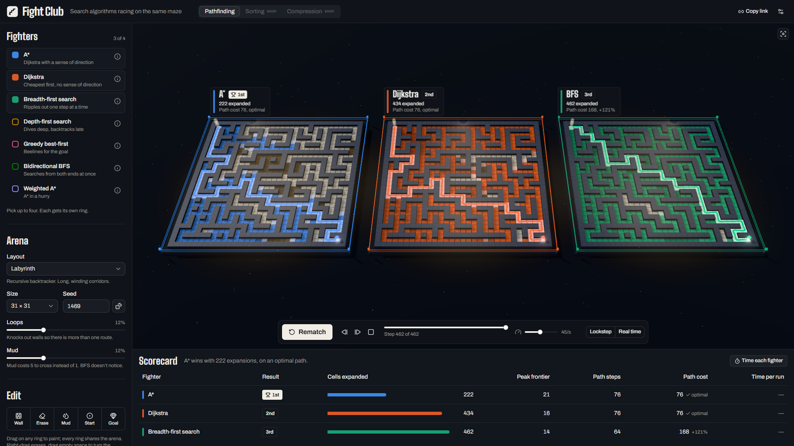

# Algorithm Fight Club

Pick up to four search algorithms, drop them into identical mazes, and watch them race. Every node expansion is animated in 3D, and the scorecard shows who won and why. The engine is C++ compiled to WebAssembly; the arena is three.js.



## What you can do

- **Pick a lineup.** A\*, Dijkstra, BFS, DFS, Greedy best-first, Bidirectional BFS and Weighted A\*. Each fighter gets its own ring, in its own colour.
- **Build the arena.** Seven layouts (recursive backtracker, Prim's, Kruskal's, recursive division, cellular-automaton caves, open floor and a dead-end trap), with sliders for loops and mud. Mud costs 5 to cross, which is where BFS and Dijkstra part ways.
- **Paint on it.** Draw walls and mud, or drag the start and goal, directly on any ring. Every ring shares one arena.
- **Race two ways.** *Lockstep* gives every fighter one expansion per tick, so it compares work done. *Real time* moves each fighter at its benchmarked speed, so it compares actual runtime. The two can disagree: on the default arena BFS expands the most cells yet runs fastest, because a FIFO queue is cheaper than a heap.
- **Scrub, step and replay** any fight, at 2 to 2,000 expansions a second.
- **Benchmark** each search with tracing compiled out (median of 7 batches).
- **Share** an arena, lineup and hand edits as a link.

## Running it

```bash
npm install
npm run dev          # http://localhost:5173
```

| Script | What it does |
| --- | --- |
| `npm run dev` | Dev server with hot reload |
| `npm run build` | Typecheck and production build into `dist/` |
| `npm run build:wasm` | Recompile the C++ engine into `src/engine/arena.wasm` |
| `npm test` | Engine, playback and share-link tests (Vitest, running the real WASM in Node) |
| `npm run lint` | Oxlint |

The compiled `arena.wasm` is committed, so the web app builds without a C++ toolchain. You only need `build:wasm` after changing `engine/src`.

## How it works

```
engine/src/*.hpp, arena.cpp      freestanding C++17, no libc, no heap
        │  npm run build:wasm    (Clang/LLD from @yowasp/clang, run by Node)
        ▼
src/engine/arena.wasm            42 KB, zero imports
        │
Web Worker (engine.worker.ts)    generate · solve (traced) · benchmark (untraced)
        │  traces: one u32 per event, transferred, not copied
        ▼
FightPlayer                      replays traces in lockstep or real time
        │  per-cell state + timestamp
        ▼
three.js stage                   instanced tiles; the GPU animates flash, pop and settle
```

### Run first, animate later

Timing a search while you animate it measures the animation, not the algorithm. So the engine runs each search to completion at full speed and records an **event trace** of every frontier push, expansion and path cell. The browser then replays that trace at whatever pace you choose, which makes scrubbing, stepping and rematches free.

Each event is a single `u32`: the opcode in the top 8 bits, the cell index in the low 24. The trace sits in WebAssembly linear memory, and JavaScript reads it through a typed-array view.

### Zero-overhead tracing

Recording is a template parameter, `Trace<bool kRecord>`, and every solver is instantiated twice. The benchmarked build contains no tracing code at all, not even a branch. A test asserts that both builds produce identical results.

### Honest timing

Browsers coarsen `performance.now()`, so one run of a 10 µs search can't be timed. After a warm-up, the benchmark grows the batch size until a batch takes at least 25 ms, then reports the median per-run time across 7 batches. It runs in the worker, so the arena keeps rendering.

### A freestanding engine

No libc, no libc++, no exceptions, no allocation. Every buffer is a fixed-size static array (arenas up to 255 × 255), so the module needs no imports and its memory never moves. It builds with `@yowasp/clang`, which is Clang/LLD compiled to WebAssembly and run by Node, so `npm install` is the whole toolchain. To use a native compiler instead, set `FC_CLANG` to a `clang++` that has the wasm32 target.

Mazes come from a seeded PCG32, so a seed reproduces the same arena on every machine.

### Rendering

Each ring is two instanced meshes: tiles (one instance per cell, so instance id equals cell index) and walls. Playback writes only a state and a timestamp per changed cell. A patched `MeshStandardMaterial` shader turns those into the hot flash, the pop and the settle into the fighter's colour, so the CPU never animates a tile. The camera fit projects the layout's corners and binary-searches the distance, so rings frame correctly at any aspect ratio, and the scoreboards above each ring never overlap a neighbour.

## Project layout

```
engine/
  build.mjs              compiles engine/src to src/engine/arena.wasm
  src/
    arena.cpp            the WebAssembly exports
    solvers.hpp          the seven searches
    generators.hpp       the seven arena generators
    containers.hpp       binary heap with packed deterministic keys
    trace.hpp, rng.hpp, state.hpp, common.hpp
src/
  engine/                WASM wrapper, worker, RPC client, algorithm metadata, tests
  fight/player.ts        trace playback (lockstep and real time)
  arena3d/               three.js stage, rings, shaders, palettes
  app/                   session orchestration, share links, preferences
  components/            React UI (shadcn/ui on Radix, Tailwind, lucide)
  state/store.ts         Zustand store
```

## Tests

`npm test` runs 27 tests against the real compiled engine:

- Every path is valid: contiguous, wall-free and correctly costed.
- A\* and Dijkstra always find the cheapest path, and BFS and bidirectional BFS the fewest steps.
- Weighted A\* stays within 2× of optimal.
- A\* never expands more cells than Dijkstra.
- Traces agree with their stats, and traced and untraced builds give identical results.
- Perfect mazes are spanning trees, generators are deterministic per seed, and start and goal are always connected.
- Playback places fighters correctly in both modes, steps exactly one expansion at a time in both directions, and finishes exactly once.
- Share links round-trip, including hand-edited grids.

## Roadmap

1. **Sorting arena.** The trace player is domain-agnostic: compares and swaps are just another event stream.
2. **Adversarial challenges.** Build the input that makes a given algorithm look bad, such as a maze that traps Greedy or a killer sequence for naive quicksort.
3. **Bring your own algorithm.** Submissions written in TypeScript against the same event API, run in a sandboxed worker with a step budget, scored on deterministic seeded arenas.
4. **Compression arena,** as a ratio-versus-speed chart rather than an animation.

## Design notes

Colour on this page always means a fighter. Chrome stays neutral, and primary actions use the spotlight's warm white. The fighter colours come from a palette validated for colour-vision deficiency, and the default lineup is the set that stays distinguishable for every viewer. Every ring and scorecard row also carries the fighter's name, so colour is never the only cue.
